<div align="center">

# Z21 UI Showcase — a full touchscreen UI, built with real widgets

**1024×600 touch display · 8 screens · from buttons to a live waveform — all native FlyThings widgets**

[](#platform-capabilities)
[-orange)](#platform-capabilities)
[](#extend-it-with-ai)
[](https://github.com/zkswe/mcp_release)

**GitHub**: https://github.com/zkswe/z21-ui-showcase ｜ **Gitee mirror**: https://gitee.com/Kwolve/z21-ui-showcase

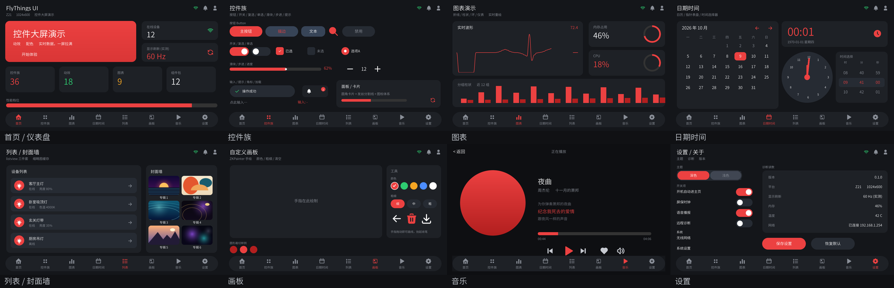

</div>

---

## What this is

A guided tour of what a touchscreen can do, running as **one app with eight screens**:

toggles flip, sliders drag, pickers spin, the calendar flips months, the waveform redraws in real time, and the cover wall scrolls — **nothing is a screenshot; every control is real and interactive**.

It is the fastest way to evaluate a display's UI capability: power it on, swipe through eight screens, and see the widget coverage at a glance.

> The UI code here was **generated from an HTML prototype with AI + our MCP toolchain** — not hand-coded widget by widget. See [Extend it with AI](#extend-it-with-ai).

---

## Why it matters

| Feature | What it means for you |
|---|---|
| **Real widgets, not images** | Switch / checkbox / radio / slider / stepper / wheel picker / calendar / list / canvas are all tappable — verify touch feel before writing code |
| **Dynamic data + image cache** | The cover wall is a **2-column `listview` + ImageCache**: items are added at runtime and rows don't re-decode on re-entry — your product lists can be long and stay smooth |
| **Real-time redraw** | The waveform redraws every frame — dashboards, monitors and industrial panels are within reach |
| **Whole product UI in one app** | 8 screens with navigation, page transitions and a status bar — far less trial-and-error per widget |
| **AI-maintainable** | Both layout and logic can be changed with AI (edit one line of HTML/json and re-render) — you don't need a dedicated GUI team (see below) |
| **Showcase as documentation** | 8 screenshots + 3 GIFs show exactly how far a screen like this can go |

---

## On real hardware

All screenshots and animations come from a **real Z21 device** (1024×600).

### Page transition
Staggered slide-in choreography (title / cards / nav bar):

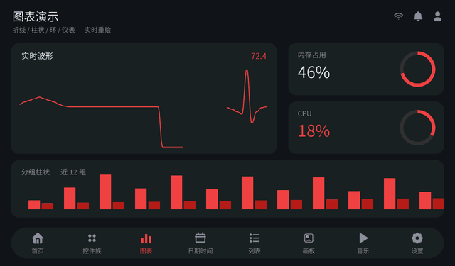

### List scrolling (cover wall = 2-column `listview`)
Dynamic data + image cache, with smooth scrolling and rebound:

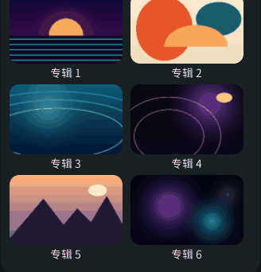

### Live waveform (frame-by-frame redraw)

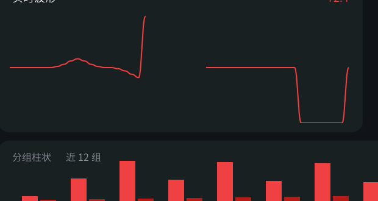

### Spinning vinyl + live spectrum (real audio playback)
On the real device the music page **actually plays audio**: the record spins while playing and stops the moment you pause, the **spectrum is computed on-device with a real FFT over the decoded PCM** (tightly synced to the audio and the playback position), and both the progress bar and the lyrics follow the **real playback position**:

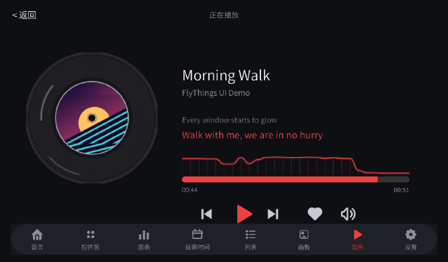

> Frame capture: frames are grabbed on-device and assembled into GIFs. Capture uses **RGB565 + region-only grab** (source: `tools/fbcap.c`): ~8.7 fps full-screen, 9–14 fps for a cropped region. GIF playback is not the on-device frame rate.

### The eight screens

| Screen | Highlights | Shot |
|---|---|---|
| **Home / dashboard** | Cards, metric tiles, progress bars, status-bar icon set | 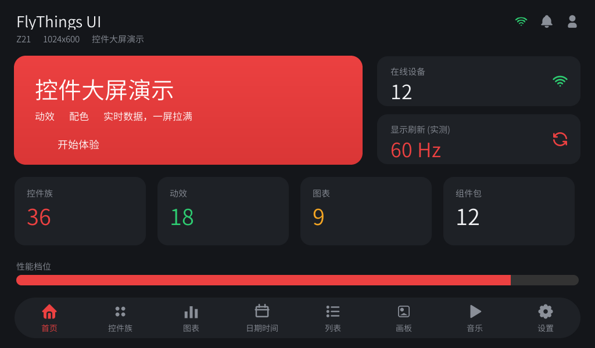 |
| **Widgets** | Buttons (filled / outline / text / disabled), switch, checkbox, radio, slider, stepper, toast, badges, text input (system IME + Pinyin) | 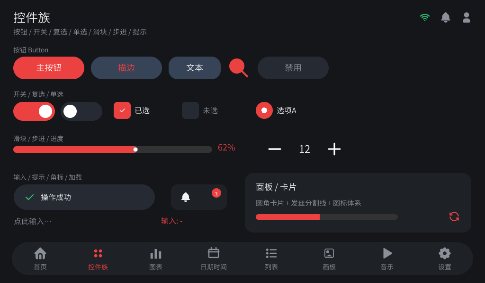 |
| **Charts** | Live line/waveform, ring progress, grouped bars (self-drawn, per-frame) | 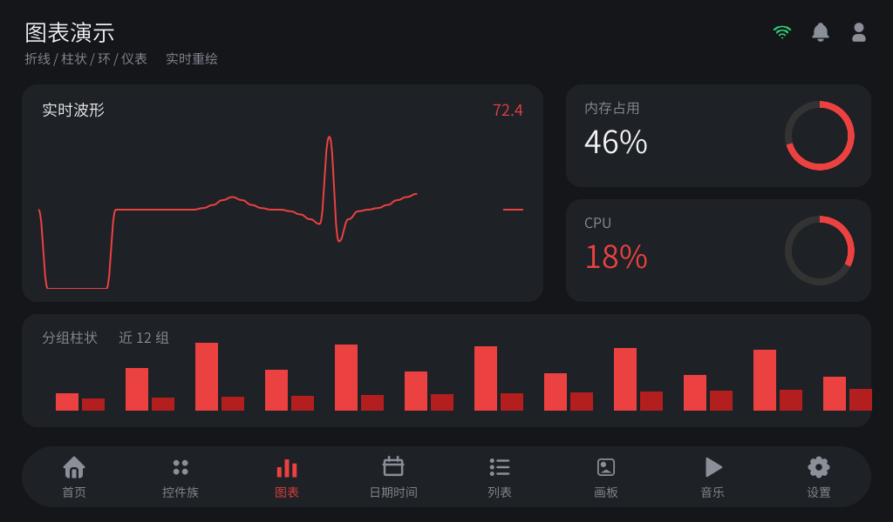 |
| **Date & time** | Digital clock, analog-style pointers, wheel pickers (Y/M/D, H/M/S), calendar (month flipping / selection) | 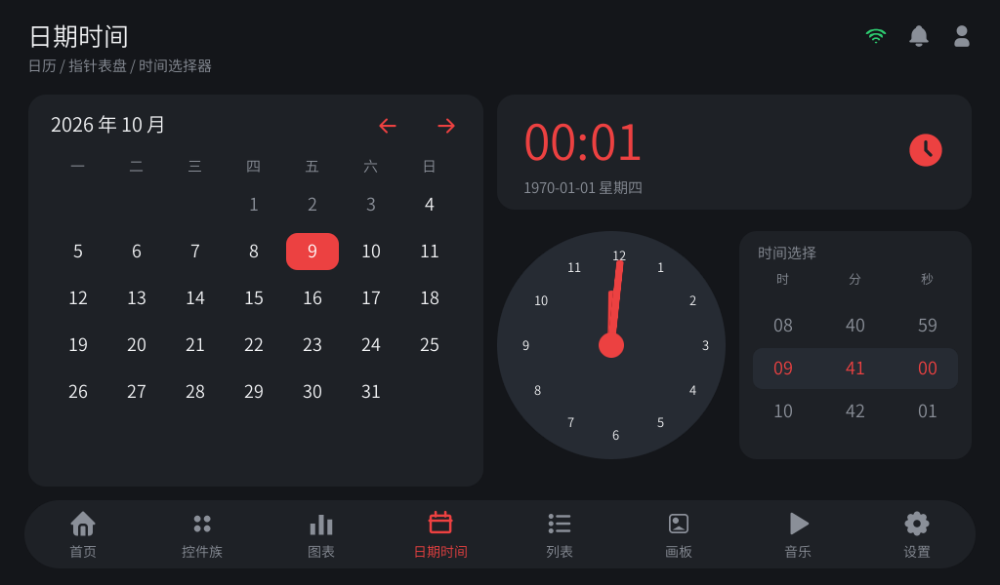 |
| **List / cover wall** | `listview` essentials; cover wall is a 2-column grid list with dynamic data + image cache | 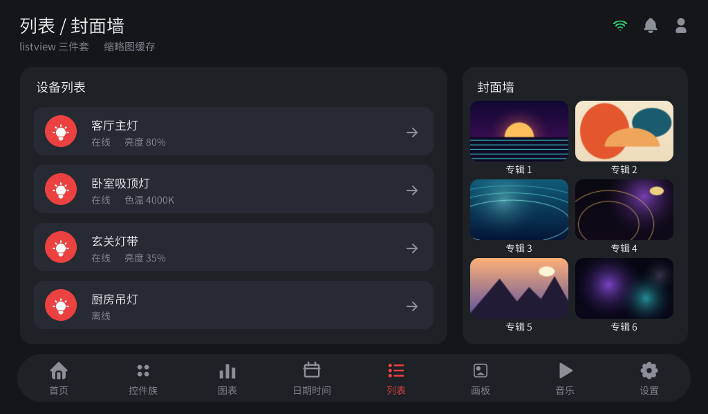 |
| **Canvas** | Self-drawn painter: finger drawing, brush size/color, undo / clear / save | 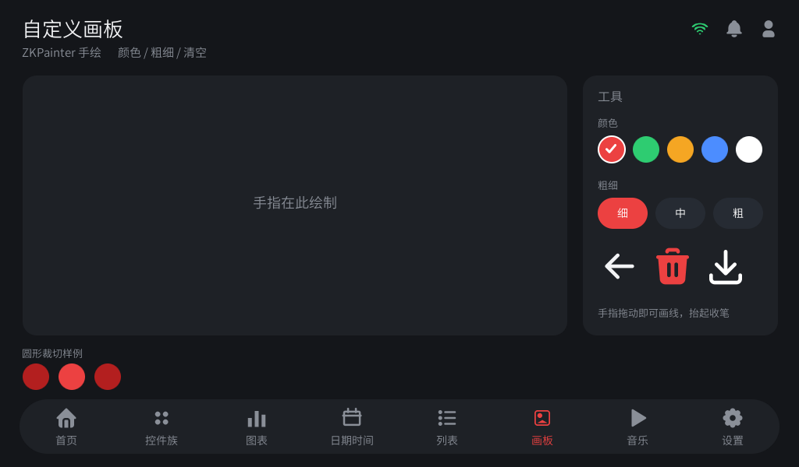 |
| **Music** | Spinning vinyl + **real audio playback**: local MP3, pause / skip / scrub / mute, time-synced lyrics + **live spectrum curve** | 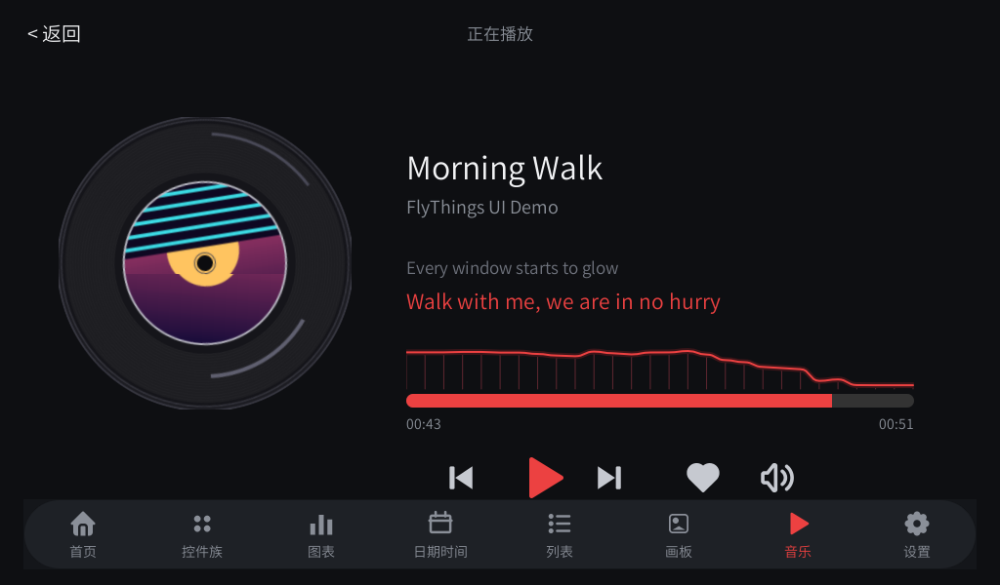 |
| **Settings / about** | Switch group, segmented control, diagnostics, save / reset | 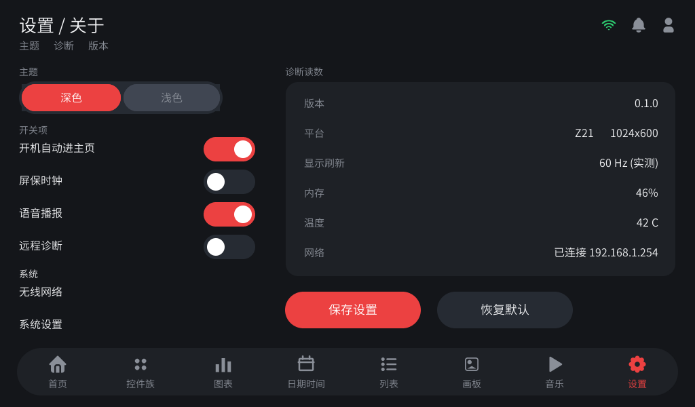 |

---

## Platform capabilities

| Item | Detail |
|---|---|
| Platform | **Z21** (FlyThings OS) |
| Display | **1024 × 600** touchscreen |
| UI system | **FlyThings UI** (in-house GUI; device artifact `zkgui` / `libzkgui.so`) |
| OS base | A **Linux**-based OS (kernel + in-house system framework + GUI); apps are ordinary Linux processes |
| App model | UI described by `ui/*.ftu`, logic in `src/logic/*.cc`; `fsc build` produces `libzkgui.so` deployed to the device |
| Input | Capacitive touch; text input via the **built-in IME with Pinyin** |
| Network / peripherals | WiFi (`zknet`) and hardware APIs such as GPIO/backlight/ADC/PWM (`zkhardware`) via components |

> Full device specs (SoC, power, I/O, storage) are in the hardware datasheet or available on request.

---

## Components used

This demo runs on a complete component chain — **everything is declared in `Manifest.xml`** and resolved by `fsc install` (transitive dependencies included), with no third-party library ported or compiled by hand:

| Package | Provides | Used here for |
|---|---|---|
| `easyui` | **The FlyThings UI widget library** (buttons, switches, sliders, lists, charts, canvas, pointer, seekbar, painter…) | Every widget and interaction on the 8 screens |
| `audio-utility` | Audio decode + playback, **playback PCM callback**, volume/mute (MI_AO backend) | Real playback, the **on-device live spectrum**, volume/mute |
| `zknet` | Networking (WiFi / connection state) | The "Wireless" switch and the system settings jump |
| `zkhardware` | Hardware APIs (GPIO / backlight / ADC / PWM / beeper) | Backlight and indicator-style hardware interaction |
| `base-utility` | Base utilities (files / functional / logging) | Shared foundation for generated and business code |
| `png` / `jpeg` | PNG / JPEG decoding | Image assets and photo-style content |
| `z` | Compression | Used by networking / upgrade paths |
| `curl` + `openssl` + `cares` | HTTPS client / TLS / async DNS | Ready-made path for online data |
| `ffmpeg` | Decode chain (audio/video software decoding) | The decode backend of `audio-utility`; **declare this one explicitly** |

> **This is where the development convenience shows**: none of the above (including what `audio-utility` pulls in automatically — `mi_ao` / `mi_aio` / `mi_sys` / `mi_common` / `apc` / `aec` / `base-json` / `rapidjson`) is ported by hand — declare a dependency, it is fetched, then just `#include` it.
> Take the music page's **on-device live spectrum**: a single line (`<package id="audio-utility" .../>`) buys the whole decode-play + playback-PCM-callback + volume/mute stack; all that was left was a 1024-point FFT (`src/zk/zk_fft.h`).

> Reusable components (BLE facade, fonts, icon library, custom widget packs) live in the MCP repo's `components/`.

---

## Extend it with AI

**This UI was generated by AI**: from an HTML prototype → `ui/*.json` → packed to `ui/*.ftu` → `fsc build` → deployed to the device.
You describe what the screen should look like; the toolchain does the rest.

| Task | How |
|---|---|
| **Change the UI** | Edit one line of HTML/json → preview → pack & build (no widget code by hand) |
| **Add a screen** | Add a full-screen `window` in the same app, or generate a new json from a prototype (one `ftu` per app; split only across business domains) |
| **Add a game / sub-page / dialog** | Copy an existing page; a dialog is just a full-screen `window` in the same page |
| **Look up a widget** | Fully offline knowledge-base search (**no API key**), or just ask the AI; official docs at `developer.flythings.cn` |
| **Verify** | Drag-and-drop UI editor → writes back to json; pixel-diff acceptance; real-device screenshots |
| **Ship to device** | `fsc build` + `fsc launch` (the screenshots here came from this loop) |

**One loop = 3 steps**

```
① describe / edit the prototype (HTML or json)  →  ② generate & preview  →  ③ build & deploy to the device
```

**MCP toolchain (the AI dev entry point)**

| Item | Link |
|---|---|
| GitHub | https://github.com/zkswe/mcp_release |
| Gitee mirror | https://gitee.com/Kwolve/flythingsmcp_release |
| Current version | `0.27.201-open` |

Install in one line: `git clone` the repo above and run `mcp_server.py` **from the repository path** (a plain `pip install` does not include the knowledge base, templates or toolchain data files).

---

## Getting started

1. **See it**: browse the screenshots and GIFs above — no setup needed.
2. **Run it**: open the project in FlyThings IDE, or from the CLI:
   ```bash
   fsc install                           # fetch the components declared in Manifest.xml
   fsc build -p Z21                      # build → libzkgui.so
   fsc launch -p Z21 -s <device-ip>:5555 # deploy and run on the device
   ```
3. **Edit the UI**: change `ui_dev/*.json` (layout source) → pack into `ui/*.ftu` → rebuild/redeploy.
   > Layout convention: `ui/` holds only what the device loads (`*.ftu` + `images/`); development-time `*.json` and previews live in `ui_dev/`.

---

## Buy & contact

- **Company**: Shenzhen Zkswe Technology Co., Ltd. (zkswe)
- **Website**: https://www.zkswe.com
- **Phone**: +86 755-23019045
- **Address**: Room 1407, Tower A, Phoenix Valley, Gongle Community, Xixiang, Bao'an District, Shenzhen, Guangdong, China

> Need a device, a core board, a custom UI, or an assessment of "your requirement → what we can build"? Talk to us.

---

## Technical notes

### Layout

```
├─ ui/          device-loaded *.ftu (build output) + images/
├─ ui_dev/      dev-time: layout source *.json, page previews
├─ src/         application code
│  ├─ logic/    per-page logic (*.cc)
│  ├─ core/     business code (music/network modules in this demo)
│  ├─ ui/ zk/   in-house page animation, navigation
│  └─ uart/     serial protocol framework (template)
├─ resources/   assets (referenced as images/xxx.png in json)
├─ font/        project font
├─ showcase/    real-device screenshots & GIFs used by this README
├─ tools/       frame-capture tool source (fbcap.c)
├─ Manifest.xml component dependencies
└─ package.properties / .project / .cproject / .settings  IDE & project config
```

### Implementation notes
- **Dynamic lists**: `listview` + the three adapter callbacks (count / fill / click), data built at runtime; the cover wall uses a **2-column grid** + **ImageCache** (caches decoded bitmaps by path; no re-decode on re-entry), with image size exactly matching the display box.
- **Animation**: staggered slide-in choreography on page entry.
- **Self-drawn**: charts and waveform redraw per frame; the canvas records strokes.
- **Music playback**: real playback via `audio-utility`'s `MediaPlayer` (`play/pause/resume/stop/seekTo`, `currentPositon()/duration()`, `getAudioInfo()` for ID3, `onCompletion/onError`). Z21 is a SigmaStar platform, so the audio path is the **MI_AO** channel (not ALSA); volume/mute go through `AudioManager` (0~50 on Z21 → AO hardware dB). The vinyl is a `pointer` widget whose angle is advanced every frame while playing and stops on pause. The three tracks are procedurally synthesised demos shipped in `resources/music/` and deployed with the app resources.
- **Live spectrum**: `MediaPlayer::onAudio` hands you the **decoded PCM** (measured: mono s16 @ 44.1 kHz, 1152 samples per frame) → the callback thread only downmixes into a ring buffer → a 40 ms timer runs a **1024-point radix-2 FFT** (`src/zk/zk_fft.h`) → 28 log-spaced bands (peak-based, per-band adaptive normalisation) → a `painter` draws band lines + glow + curve. Pausing freezes it; scrubbing jumps it.
  > Note: `audio-utility` decodes through ffmpeg, so the project manifest must **explicitly** declare `ffmpeg` (the package does not) — otherwise the link fails on `av_*` / `swr_*`.
- **Asset generation**: icons and covers are generated to the exact widget box (rounded corners via coverage alpha, scaling via area averaging — no edge ringing).

### Known limitations
- The demo focuses on widget/interaction coverage; business data is mostly sample data.
- The music tracks are **procedurally synthesised demos** (no vocals, no licensing issues) and the lyrics are demo text synced by time; drop your own MP3s into `resources/music/` to play real songs.
- GIFs are captured-frame playback (not the live frame rate); measure the device for real performance.

### License
This repository is **sample code** for evaluation and further development; contact us for commercial use and redistribution.

<div align="center">

**Shenzhen Zkswe Technology Co., Ltd. · FlyThings OS / FlyThings UI**

</div>
